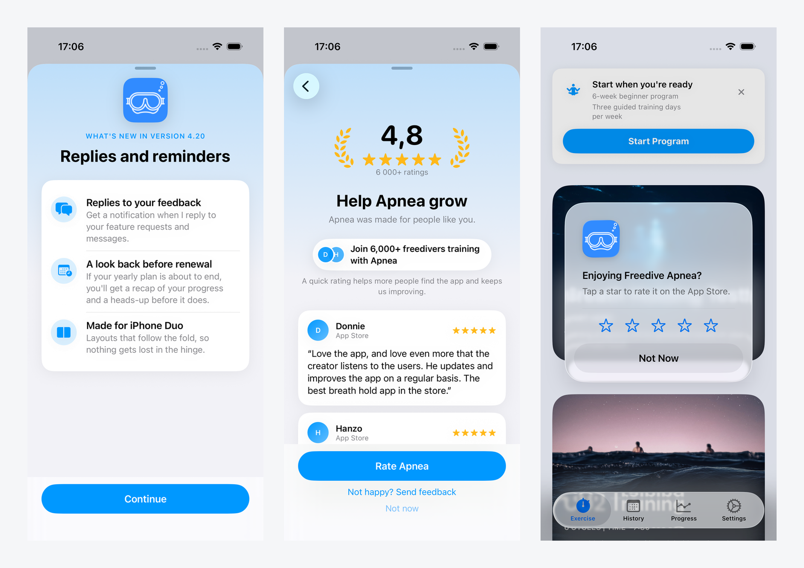
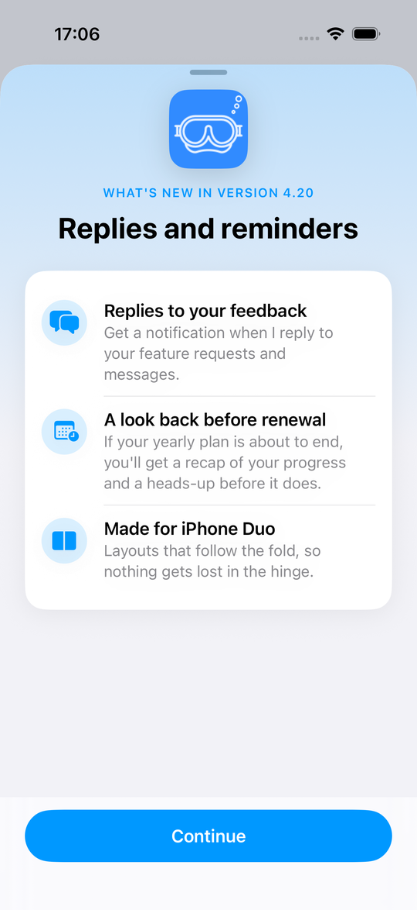
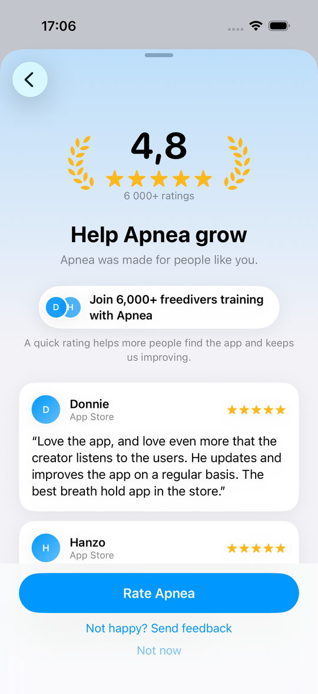
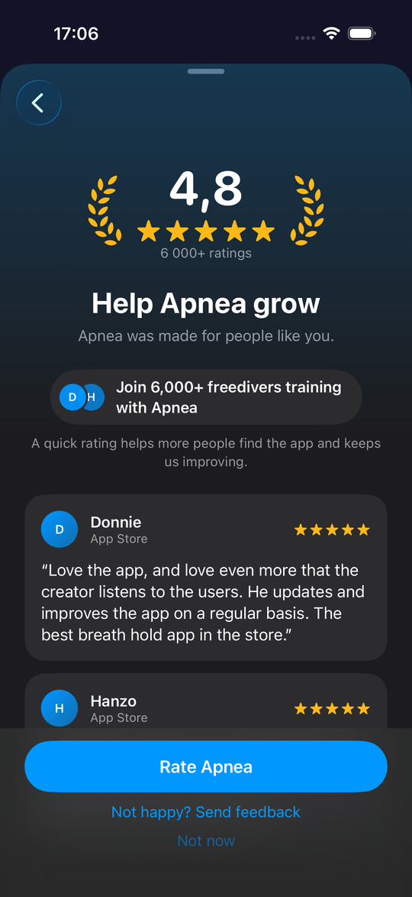
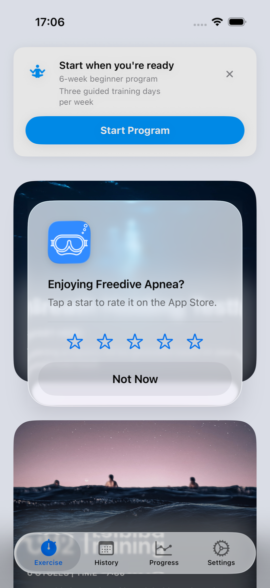
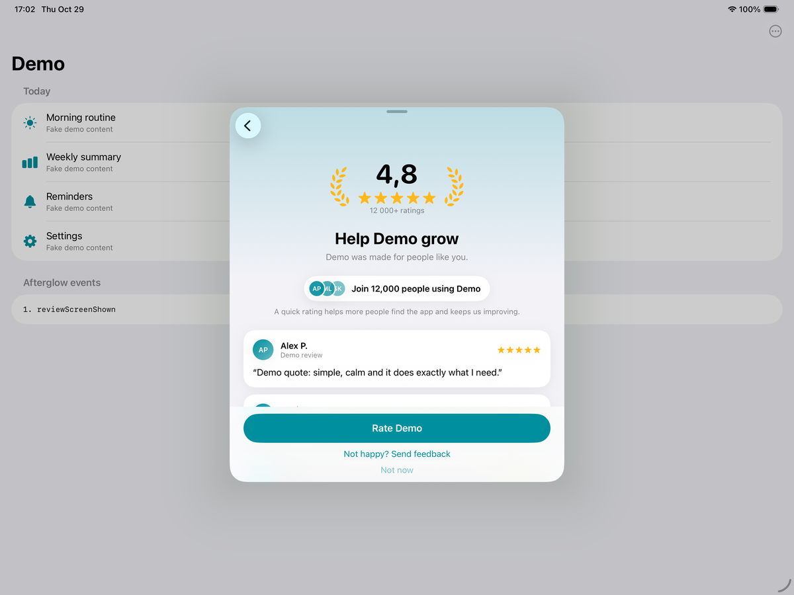

# Afterglow

A What's New sheet that, at most once per minor version, pushes a review screen onto the same sheet, shown right after an app update. SwiftUI, Swift 6, no dependencies, no backend.

- iOS 17+ (verified on iPhone and iPad); macOS 14+ (builds and lays out in tests, not yet used in a shipping Mac app)
- Chrome strings localized in en, de, es, fr, ko, zh-Hant
- MIT licensed



## Installation

Swift Package Manager: `.package(url: "https://github.com/aivars/afterglow", from: "1.0.0")`. In Xcode, choose File > Add Package Dependencies and enter `https://github.com/aivars/afterglow`.

## Screenshots

As shipped in [Freedive Apnea](https://apps.apple.com/app/id1188724407) with its real App Store reviews; the iPad shot is the example app.

| What's New | Review screen | Review screen, dark | Prompt after dismissal |
|---|---|---|---|
|  |  |  |  |



## Try it

`Example/AfterglowExample.xcodeproj` is a universal (iPhone and iPad) demo app wired to the package. Open it in Xcode and run it on any simulator, or see the launch arguments under [iPad](#ipad).

## Integration

```swift
import Afterglow
import SwiftUI

@main struct MyApp: App {
    var body: some Scene {
        WindowGroup {
            RootView().afterglow(AfterglowConfiguration(
                appStoreID: "123456789",
                appName: "MyApp",
                releaseNotes: [ReleaseNote(version: "4.21", title: "Custom tables", items: [
                    .init(systemImage: "tablecells", headline: "Build your own", detail: "Design tables that fit your level."),
                ])],
                testimonials: [Testimonial(quote: "Finally makes sense.", author: "Scott E.", source: "App Store")],
                feedbackAction: { showFeedback = true },          // optional; hides the link when nil
                onEvent: { Analytics.track("afterglow_\($0.rawValue)") },
                policy: AfterglowPolicy(isEligibleUser: { UserDefaults.standard.bool(forKey: "onboarded") }),
                canPresent: { !paywallIsUp },                     // yield to your own covers
                ratingSummary: RatingSummary(average: 4.8, count: 6059),  // optional laurel badge: "4.8" and "6,000+ ratings"
                heroImage: .named("AppIcon60x60")                 // optional What's New hero; falls back to a sparkles tile
            ))
        }
    }
}
// Settings: Afterglow.shared.presentWhatsNew()   Afterglow.shared.presentReview()   Afterglow.shared.openWriteReview()   Debug: Afterglow.shared.reset()
```

Check `Afterglow.shared.isPresenting` before presenting your own sheets. It is true for the whole sheet, What's New and review screen alike.

## Flow

```
update detected
  -> ONE sheet opens: What's New (root of a NavigationStack)
       swipe down            -> sheet closes, no review screen, no events beyond whatsNewShown
       Continue (no review)  -> sheet closes
       Continue (review due) -> review screen is PUSHED onto the same sheet (no dismiss and re-present)
            "Rate <app>"     -> opens the App Store write-review page, sheet closes, no system prompt
            "Send feedback"  -> sheet closes, host's feedbackAction runs, no system prompt
            "Not now" / swipe down (also after going back)
                             -> sheet closes, `dismissed` is emitted, then after `promptDelay`
                                (default 0.6 s) Apple's system rating prompt is requested
                                and `systemPromptRequested` is emitted
```

If your app shipped before you added Afterglow, call `Afterglow.shared.seedExistingUser(lastSeenVersion: "4.20")` once at launch (for users you know are existing), otherwise everyone looks like a fresh install and the first release shows nothing.

## Settings rows

- `presentWhatsNew()` shows What's New only; Continue dismisses.
- `presentReview()` offers the review screen from a "Rate <app>" row. It opens the same sheet with the review screen already pushed (the back button reveals What's New for the running version, or the newest note), records the screen as shown for this version and emits `reviewScreenShown`. It ignores the once-per-version and cooldown rules because the user asked for it, and it needs at least one release note. Dismissal follows the usual rules: "Not now" or a swipe requests the system prompt after `promptDelay`; "Rate" and "Send feedback" do not.

## iPad

- On iPad the sheet is the system form sheet (`presentationSizing(.form)`, iOS 18 and later; on iOS 17 iPad it is the default sheet). Full-height detents are applied only at compact width (iPhone and narrow windows).
- Both screens keep their content in a centered 560-pt readable column, and the buttons at the bottom are capped to the same width, so a wide sheet never stretches the cards or the capsule button edge to edge. iPhone layouts are unchanged (every iPhone is narrower than 560 pt).
- Run `Example/AfterglowExample.xcodeproj` on an iPad simulator to see it. Launch arguments, passed after the bundle id (`xcrun simctl launch <udid> com.aivarsmeijers.AfterglowExample --afterglow-demo`):
  - `--afterglow-demo`: reset, pretend the user updated from 1.0 (the example is 1.1), and run the full What's New then review flow.
  - `--afterglow-review`: reset and present the review screen directly with `presentReview()`.
  - `--landscape`: ask the window scene for landscape. iPadOS 26 windowed apps refuse programmatic rotation (rotate the simulator instead, Device > Rotate).
  The toolbar menu also has "Simulate upgrade", "Show What's New", "Show review screen" and "Reset", and an event log at the bottom of the list shows the event sequence live.

## Localization

Afterglow localizes its own chrome only: the buttons ("Continue", "Not now", "Write a review", "Not happy? Send feedback"), the headings and labels ("What's new in 4.21", "Help <app> grow", "Rate <app>", "Version 4.21"), the one-line "why rate" text, and the rating badge line ("6,000+ ratings", with the number formatted for the user's locale). Shipped languages: en, de, es, fr, ko, zh-Hant.

App content is localized by the host app: release notes, testimonials and the community line are plain strings you pass in, so hand over already-localized values (for example from your own `String(localized:)` or a per-locale table). The package never translates them.

To add a language, edit `Sources/Afterglow/Resources/Localizable.xcstrings` (open it in Xcode's string catalog editor and add the language, or add the entries to the JSON), then run `swift test`. PRs are welcome.

## Measuring it

Afterglow does not measure its own effect, so set up a before/after comparison:

- Compare new ratings per week, per storefront, for the four weeks before and the four weeks after the first release that carries Afterglow (App Store Connect, Ratings and Reviews, or any rating tracker). Look per storefront: a prompt in one country says little about another.
- Watch the average for a drop. Asking more people to rate also reaches people who would not have rated unprompted, and some of them rate low.
- Use the `AfterglowEvent` stream from `onEvent` for the funnel: `whatsNewShown`, then `reviewScreenShown`, then `writeReviewTapped` or `dismissed` (`feedbackTapped` is the other exit). `systemPromptRequested` follows `dismissed`.

One honest caveat: Apple shows its system rating prompt at most three times per year per user, and the app cannot tell whether it appeared. `systemPromptRequested` means the request was made, not that the prompt was shown, so the funnel ends at the request and the rating count in App Store Connect is the only outcome you can observe.

## Content

- **What's New**: 3 to 5 rows per release. More than 5 is fine (the sheet scrolls) but dilutes the message.
- **Testimonials**: up to 3 are shown. Keep each quote under about 220 characters; the view never truncates, so a long quote makes a tall card. DEBUG builds hit an `assertionFailure` above 400 characters; release builds never crash.
- **Rating badge**: pass the raw `RatingSummary(average:count:)`. The sheet rounds the count down ("6059" becomes "6,000+", "348" becomes "300+", under 100 stays exact) and localizes it. Below `minimumRatingCount` (default 50) or `minimumRatingAverage` (default 4.0) the badge shows plain stars, because a small or weak number hurts more than it helps.
- **Optional pieces**: with no `communityLine` the pill is omitted; with no `testimonials` the cards are omitted and the pill shows without avatars; with neither, only the badge, title, subtitle and one-line "why rate" text show.

## Choosing icons

- One SF Symbol per row. Pick the filled variant (`bell.fill`, not `bell`) so the icon holds up inside the tinted circle.
- Prefer concrete nouns: `bell` for reminders, `chart.line.uptrend.xyaxis` for progress, `tablecells` for tables, `applewatch` for the watch app.
- Check availability for your minimum iOS in the SF Symbols app (the Availability inspector shows the first OS for each symbol).
- If a symbol name does not resolve on the running OS (a typo, or a symbol newer than the device), the row shows `sparkles` instead of a blank circle. A missing `.named` asset falls back the same way. Treat a sparkles row in testing as a bug in the name.
- App artwork works too: `.init(image: .named("MyAsset"), headline: ..., detail: ...)`.

## Rules baked in

- Minor-version change only. `4.20.1` to `4.20.2` never shows; `4.20` to `4.21` does. `2026.MM.x` schemes work the same way.
- Never on a fresh install. The first What's New a user sees is for the first update after they installed.
- One sheet, one navigation stack: Continue pushes the review screen instead of dismissing and presenting a second sheet. Settings' `presentWhatsNew()` shows What's New only and Continue dismisses.
- The system rating prompt is requested only after the review screen has been dismissed without the user tapping "Rate" or "Send feedback" ("Not now", or a swipe down), `promptDelay` (default 0.6 s) after the sheet is gone. It is never requested while the review screen is on screen and never from a button tap. The `.afterglow` modifier hands the `requestReview` environment action to the coordinator for this.
- The call to action is a plain deep link to the App Store write-review page.
- No gating question. Everyone sees the same button; "Send feedback" is a secondary link and never a filter.
- Review screen at most once per minor version.
- 365-day cooldown after the user taps the write-review button.
- Skipped minors show only the newest note: a user going from 4.19 to 4.21 sees the 4.21 note, never 4.20.
- If the host says it is not eligible, the install is too new, or there is no release note for this version, nothing shows and the version is still recorded, so stale notes never appear later.
- Events: `whatsNewShown`, `reviewScreenShown` (when the review screen is pushed), `writeReviewTapped`, `feedbackTapped`, `dismissed`, then `systemPromptRequested` (only after `dismissed`, when the request is actually made).

### Expected edge case

If a user rated in Apple's system prompt (so Apple will not show it again) but never tapped the write-review button, the review sheet can still appear on the next minor version. The package cannot see the system prompt's outcome, so this is expected: the sheet then offers only the deep-link button. It is one more reason to keep the sheet polite: one ask per minor version, an obvious "Not now", and no gate.

## Why not in onboarding

A rating ask in onboarding, before the user has done anything, is the pattern App Review has been rejecting since June 2026. Guideline 5.6.1 says to use Apple's provided API for review prompts and disallows custom ones, and the StoreKit guidance asks for it at a natural break after a completed experience, not at launch. Guideline 5.6.3 prohibits manipulating or attempting to manipulate ratings and reviews, which a gate ("enjoying the app?") or a testimonial wall in a first-run flow starts to look like. After an update the user has history with the app, the ask is rare (once per version), and the sheet uses the system prompt plus a plain link to the App Store review page, so it stays on the right side of both rules.

## License

MIT, see [LICENSE](LICENSE).
